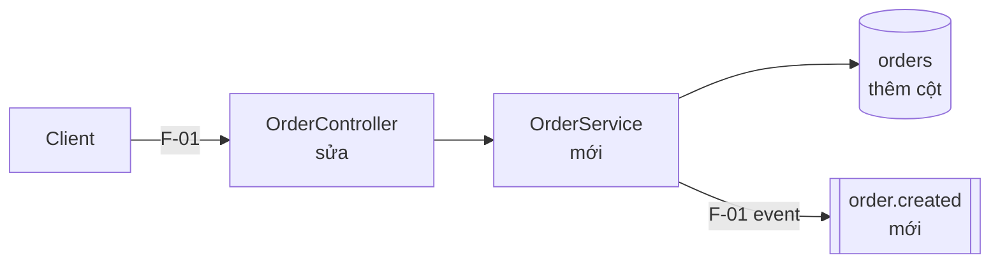

# <Tên feature> — Implementation Plan

> Status: DRAFT | APPROVED | IN_PROGRESS | DONE
> Design nguồn: `docs/superpowers/specs/<YYYY-MM-DD-topic>-design.md` (đã duyệt <ngày>)
> Task list: `docs/TASKS.md` | Tracker ngoài: <tên/link nếu project chỉ định> | —
> File này là **index cho người duyệt**: quyết định, phạm vi, rủi ro. Hành vi chi tiết nằm trong `docs/flows/`; cách làm từng task nằm trong `docs/TASKS.md`.
> Người duyệt: đọc §1 → flow rủi ro cao → §17. Người thực thi: đọc brief task + flow nó trỏ tới; chỉ mở file này khi brief tham chiếu một mục cụ thể.
> Mỗi thông tin nằm một nơi; nơi khác chỉ ghi ID.

## 1. Tóm tắt cho reviewer

Viết **sau cùng**, khi flow và task đã xong. Chỉ tổng hợp và trỏ ID; không chép nội dung.

**TL;DR:** <≤ 3 câu: làm gì; chạm contract công khai / dữ liệu / auth hay không; số flow, số task, số task rủi ro cao.>

**Thay đổi phá vỡ:** không | <contract/dữ liệu/hành vi đổi với client hoặc dữ liệu hiện có — ID>

**Điểm cần duyệt** (mọi mục phải có quyết định trước khi Status = APPROVED):

| # | Loại | ID | Cần quyết gì | Agent đề xuất |
| --- | --- | --- | --- | --- |
| 1 | đề xuất | F-01.B3 | <nhánh/invariant/mã agent tự thêm> | giữ / bỏ |
| 2 | GAP | F-02 (Trường hợp không liệt kê) | <trường hợp chưa có cơ sở> | <phương án> |
| 3 | DEC | DEC-002 | <quyết định agent đề xuất> | <phương án> |
| 4 | rủi ro cao | T-03 | <auth / dữ liệu / contract — vì sao> | soát diff sau thực thi |
| 5 | CHƯA XÁC ĐỊNH | T-04 Done khi | <lệnh/giá trị chưa tìm thấy> | <…> |

Loại hợp lệ: `đề xuất`, `GAP`, `DEC` (nguồn = agent), `rủi ro cao`, `CHƯA XÁC ĐỊNH`, `Q` (trỏ `Q-nn` ở §18). Không mục nào → ghi "Không có".

## 2. Vấn đề và mục tiêu

- **Hiện trạng:** <hành vi hôm nay + bằng chứng `path:line` / ticket / số liệu>
- **Vấn đề:** <hậu quả cụ thể của hiện trạng; ai bị ảnh hưởng>
- **Mục tiêu:** <1–3 câu: kết quả quan sát được khi xong; chi tiết kiểm chứng ở §6>

## 3. Thuật ngữ

Bỏ nếu feature không có khái niệm nghiệp vụ mới hoặc dễ nhầm; ghi lý do một dòng. Một thuật ngữ cho một khái niệm; flow và task dùng đúng thuật ngữ này.

| Thuật ngữ | Nghĩa trong feature này | Tên trong code (`path:line`) | Không dùng |
| --- | --- | --- | --- |
| <đơn hàng> | <…> | `Order` (`src/order/order.ts:12`) | <"phiếu", "bill"> |

## 4. Phạm vi

**Được sửa** (ngoài danh sách này = phải hỏi lại):

- `<glob hoặc path>`

**Non-goals:**

- NG-01 <việc cố ý không làm>

**Hành vi hiện có phải bảo toàn:**

- <hành vi> — bảo vệ bởi `<test hiện có hoặc REQ-xxx>`

## 5. Ràng buộc và yêu cầu phi chức năng

Mỗi dòng một `C-nn`, MUST / MUST NOT, giá trị chính xác (số, đơn vị, tên). Xét đủ các loại: tương thích ngược, bảo mật/authz, dữ liệu nhạy cảm, hiệu năng, observability, tài nguyên/giới hạn. Loại không áp dụng → ghi ở dòng "Không áp dụng" kèm lý do.

| ID | Loại | Ràng buộc | Kiểm bằng |
| --- | --- | --- | --- |
| C-01 | tương thích | MUST giữ nguyên response `GET /orders/{id}` | test hiện có `<path>` |
| C-02 | hiệu năng | MUST p95 `POST /orders` < 200 ms với 50 rps | `<lệnh load test>` / review |
| C-03 | bảo mật | MUST NOT log `card_number`, `email` | test log / review |

Không áp dụng: <loại — lý do> | —

## 6. Requirements

| ID | Requirement | Acceptance criteria (kiểm chứng được) | Flow |
| --- | --- | --- | --- |
| REQ-001 | <…> | <hành vi quan sát được / lệnh test> | F-01 |

## 7. Flows

| ID | Flow | Trigger | Actor / quyền | File | Rủi ro |
| --- | --- | --- | --- | --- | --- |
| F-01 | <tên> | <API/event/job> | <role> | [F-01-<slug>](flows/F-01-<slug>.md) | cao / thường |

## 8. Thành phần bị ảnh hưởng

Bắt buộc. Thành phần mới / sửa / chỉ đọc, nhãn cạnh là `F-nn`. ≤ 15 node; chỉ vùng thay đổi.

**Repository baseline** — chỉ ghi điểm đã đọc thật, dạng `path:line`. Không bịa file.

- `<path:line>` — <entry point / module / pattern cần tái dùng>
- Cấu trúc vùng thay đổi: `<dir>/` — <lớp/module: entry point, application/domain, persistence, adapter>
- Stack: <Java/Spring | TypeScript/Node | Python | Go | không có adapter> — theo `<manifest>`; integration: <Kafka, Redis cache, …> | —
- Convention error code: `<path:line>` | không có
- Doc hiện có: `<README.md, docs/…, openapi.yaml, CHANGELOG.md>` — <bề mặt mỗi file đang mô tả>

## 9. Contract và dữ liệu

Chỉ phần thay đổi; mục con không áp dụng → bỏ và ghi lý do một dòng. Hành vi runtime (ghi gì ở bước nào) nằm trong flow.

**API / event:**

| Bề mặt | Thay đổi | Tương thích ngược | Flow / DEC |
| --- | --- | --- | --- |
| `POST /orders` | <thêm field `note` tùy chọn> | có / không: <client nào vỡ> | F-01 |

**Schema / migration:**

| Store | Thay đổi | Tương thích với code cũ | Backfill | Rollback | Task |
| --- | --- | --- | --- | --- | --- |
| `orders` | <thêm cột `note TEXT NULL`> | có — cột nullable | không / <cách, khối lượng> | <down migration / giữ cột> | T-01 |

## 10. Phụ thuộc ngoài

Bỏ nếu không gọi hệ thống/thư viện/team ngoài repo; ghi lý do một dòng. Timeout/retry/fallback nằm trong flow ("Gọi ngoài").

| Phụ thuộc | Dùng cho | Phiên bản / contract | Chủ sở hữu | Mới thêm? | Khi không sẵn sàng |
| --- | --- | --- | --- | --- | --- |
| <payment-api> | F-02.S3 | `v2`, `<link spec>` | <team> | không | F-02.B4 |

## 11. Quyết định thiết kế

| ID | Quyết định | Phương án đã loại | Đánh đổi | Nguồn |
| --- | --- | --- | --- | --- |
| DEC-001 | <…> | <…> | <…> | người dùng / agent đề xuất |

Chỉ ghi quyết định ảnh hưởng contract, dữ liệu hoặc trade-off đáng kể (theo `GOV-DEC-001`). Nguồn = agent đề xuất → có dòng ở §1.

## 12. Rủi ro

Bỏ nếu không có rủi ro đáng kể; ghi lý do một dòng.

| Rủi ro | Ảnh hưởng | Khả năng | Giảm thiểu | ID liên quan |
| --- | --- | --- | --- | --- |
| <…> | cao / vừa / thấp | cao / vừa / thấp | <test, flag, thứ tự task> | T-01, F-02.B3 |

## 13. Kế hoạch task

Index thứ tự, không chép nội dung task (chi tiết ở `docs/TASKS.md`). Phụ thuộc đi từ gốc lên; task rủi ro cao sớm nhất có thể. Tracker ngoài → cột Task ghi thêm ID item.

| Phase | Task | Slice (flow / nhánh) | Quy mô |
| --- | --- | --- | --- |
| 1 Nền | T-01 | contract + migration dùng chung | S |
| 2 <…> | T-02 | F-01.S1–S4, B1–B2 | M |

Checkpoint: step cuối của task cuối mỗi phase — chạy lệnh ở §16.

## 14. Chiến lược test

Một dòng mỗi cấp test feature dùng; cấp không dùng → ghi lý do. Fixture riêng của task nằm trong task.

| Cấp | Phủ gì | Lệnh | Môi trường / dữ liệu |
| --- | --- | --- | --- |
| unit | domain, validate (F-nn.B validate) | `<lệnh>` | không I/O |
| integration | repository, migration, event | `<lệnh>` | <Testcontainers Postgres 15 / DB test> |
| e2e / contract | <API công khai> | `<lệnh>` | <…> |

Dữ liệu test dùng chung: `<path fixture/factory>` | —

## 15. Rollout / rollback

Bỏ nếu thay đổi chỉ cần deploy thường và revert commit là đủ; ghi lý do một dòng.

- Thứ tự deploy: <migration → code → bật flag>
- Feature flag: `<tên>` — mặc định <tắt>; điều kiện bật
- Code cũ và mới chạy song song: <an toàn vì … | không, cần …>
- Rollback: <bước, theo thứ tự; dữ liệu đã ghi xử lý thế nào>
- Theo dõi sau deploy: <metric/log ở flow nào, ngưỡng báo động>

## 16. Definition of Done

Lệnh thật của repo; không tìm thấy → `CHƯA XÁC ĐỊNH: <lý do>` + dòng ở §1.

- Full test: `<lệnh>` → PASS
- Build / lint / type-check: `<lệnh>` → exit 0
- Ma trận truy vết trong `docs/TASKS.md` không còn ô trống; mọi test trong ma trận PASS
- Doc ở mọi `Docs:` của task đã cập nhật
- <Kiểm tra thêm của feature: migration chạy lên/xuống trên DB test, load test C-02> | —

## 17. Checklist duyệt

Người duyệt tick ở cổng 2. Agent không tick.

- [ ] Non-goals và "Hành vi phải bảo toàn" đúng ý
- [ ] Giá trị trong §5 đúng (số, tên, quyền)
- [ ] Bảng nhánh và "Trường hợp không liệt kê" của flow rủi ro cao đúng nghiệp vụ
- [ ] Mọi thay đổi ở §9 có tương thích ngược hoặc rollback chấp nhận được
- [ ] Task rủi ro cao đúng và đủ

## 18. Câu hỏi mở

Phải **trống** (hoặc mọi mục đã có câu trả lời) trước khi Status = APPROVED.

- [ ] Q-01 <câu hỏi> — ảnh hưởng: <REQ/F/C nào> — đề xuất: <…>

## 19. Lịch sử thay đổi

Không xóa nội dung cũ. Mỗi thay đổi ghi:

- <YYYY-MM-DD> [nhỏ|lớn] <ID bị ảnh hưởng> — Trước đây: <…>. Nay: <…>. Vì: <lý do/bằng chứng>.
