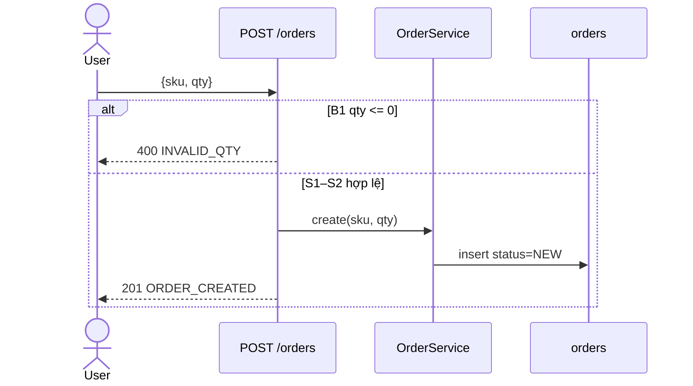
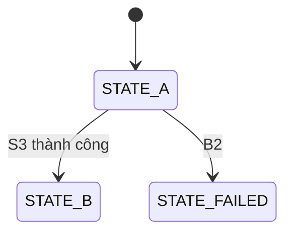

# F-nn <Tên flow>

> Requirements: REQ-xxx, REQ-yyy | Ràng buộc liên quan: C-xx | Rủi ro: cao / thường
> Flow là nguồn sự thật cho hành vi. Thuật ngữ theo §3 của plan.

## Bối cảnh

- Actor: <user / service / job>
- Trigger: <METHOD /path | topic | schedule>
- Precondition: <trạng thái bắt buộc trước khi chạy; vi phạm → nhánh `B`>
- Transaction boundary: <bước nào nằm chung transaction, ví dụ S2–S4>

## Quyền truy cập

Bỏ nếu trigger không có caller (job nội bộ); ghi lý do một dòng.

- Được gọi: <role/scope/điều kiện sở hữu, ví dụ `role=CUSTOMER` và `order.user_id = caller`>
- Kiểm ở: <middleware/guard/bước S, `path:line` của cơ chế hiện có>
- Không đủ quyền: <nhánh `B`> — không tiết lộ tài nguyên tồn tại hay không: <có / không áp dụng>

## Validate input

Kiểm ở biên, trước mọi ghi. Mỗi rule sai trỏ đúng một nhánh `B`; mã nằm ở "Mã kết quả". Bỏ nếu trigger không có input; ghi lý do một dòng.

| Field | Kiểu / bắt buộc | Rule | Sai → nhánh |
| --- | --- | --- | --- |
| `qty` | int, bắt buộc | 1 ≤ qty ≤ 100 | B1 |
| `sku` | string, bắt buộc | khớp `^[A-Z0-9]{2,20}$`, tồn tại trong `products` | B1 / B2 |

Field thừa / không biết: <bỏ qua | 400 `UNKNOWN_FIELD` (B?) | theo validator hiện có `path:line`>

## Các bước

Mọi điều kiện rẽ nhánh phải có dòng `B` tương ứng. Nhánh agent tự thêm (người dùng chưa nói) ghi `(đề xuất)` để duyệt ở cổng 2. Nhánh chưa rõ ghi `TODO` và đưa vào Câu hỏi mở.

| # | Bước | Điều kiện rẽ nhánh → nhánh | Kết quả / side effect |
| --- | --- | --- | --- |
| S1 | <bước> | <điều kiện> → B1 | <kết quả happy path> |
| S2 | <bước> | — | <…> |

## Diagram

Bắt buộc. Actor → entry point → service → store/integration; happy path đủ bước, mỗi `B` là một nhánh `alt`/`else` nhãn `Bk` kèm mã trả về.



## Mã kết quả

Bắt buộc. Mỗi `S` kết thúc và mỗi `B` có đúng một dòng. Không phải HTTP (job/event) → ghi status/event tương ứng.

| Mã | HTTP/status | Bước/nhánh | Body/payload |
| --- | --- | --- | --- |
| `ORDER_CREATED` | 201 | S2 | `{id, status:"NEW"}` |
| `INVALID_QTY` | 400 | B1 | `{code, message}` |

## Nhánh lỗi / biên

| # | Khi nào | Hành vi | Trạng thái dữ liệu sau đó | Mã |
| --- | --- | --- | --- | --- |
| B1 | <…> | <…> | không đổi / <…> | <mã trong "Mã kết quả"> |

## Trường hợp không liệt kê

Bắt buộc. Mặc định cho input/lỗi không có trong bảng nhánh: <dùng `<handler/validator hiện có, path:line>` | giữ hành vi hiện có | GAP (đã có trong Câu hỏi mở)>

## Ví dụ happy path

Một cặp đầy đủ, giá trị thật, khớp dòng happy của "Mã kết quả". Không phải HTTP → message/event vào và trạng thái dữ liệu trước/sau.

```http
POST /orders
Authorization: Bearer <token CUSTOMER>
Content-Type: application/json

{"sku":"A1","qty":2}

HTTP/1.1 201 Created
{"id":"ord_123","status":"NEW"}
```

## Thay đổi dữ liệu

Mọi ghi và mọi đọc có khóa. Bỏ nếu flow chỉ đọc không khóa; ghi lý do một dòng. Thay đổi schema nằm ở §9 plan.

| Store | Thao tác | Field / điều kiện | Bước | Trong transaction |
| --- | --- | --- | --- | --- |
| `orders` | insert | `status=NEW`, `user_id=caller` | S2 | có (S2–S3) |
| `stock` | select for update → update | `qty -= :qty` where `sku=:sku` | S3 | có |

## Side effect và event

Bỏ nếu flow không phát event, gửi mail, gọi webhook hay ghi cache; ghi lý do một dòng.

| Tên (topic / event / cache key) | Bước | Payload / giá trị | Thời điểm so với commit | Phát thất bại → |
| --- | --- | --- | --- | --- |
| `order.created` | S4 | `{orderId, userId, total}` | sau commit, qua outbox | retry outbox; response không đổi |

## Gọi ngoài

Bỏ nếu flow không gọi hệ thống ngoài process; ghi lý do một dòng. Danh mục phụ thuộc nằm ở §10 plan.

| Hệ thống / endpoint | Bước | Timeout | Retry (số lần, backoff, điều kiện) | Lỗi / hết retry → nhánh |
| --- | --- | --- | --- | --- |
| `payment-api POST /charges` | S3 | 3 s | 2 lần, 200 ms ×2, chỉ 5xx/timeout | B4 |

## Trạng thái

Bỏ nếu flow không có lifecycle; ghi lý do một dòng.



Chuyển trạng thái bị cấm: <A → C, …>. Terminal: <…>.

## Invariants

- I1 <điều luôn đúng, ví dụ: mỗi key chỉ được xử lý đúng một lần>

## Idempotency và concurrency

Bỏ từng dòng không áp dụng kèm lý do.

- Idempotency: <key (header/field) — lần lặp trả gì — lưu key bao lâu> | không áp dụng: <vì sao>
- Đồng thời: <hai request cùng tài nguyên → kết quả của mỗi bên, nhánh `B`>
- Khóa: <optimistic `version` | `select for update` | unique constraint `<tên>`>
- Retry từ phía gọi: <an toàn vì … | không an toàn → nhánh `B`>

## Observability

Không log dữ liệu thuộc `C-*` loại bảo mật/dữ liệu nhạy cảm. Dùng logger/metric hiện có (`path:line`).

| Bước / nhánh | Log (level, field) | Metric (tên, tag) | Trace span |
| --- | --- | --- | --- |
| S2 | info `order_created` `{orderId}` | `orders_created_total` | `order.create` |
| B4 | warn `payment_failed` `{orderId, code}` | `payment_errors_total{code}` | — |
