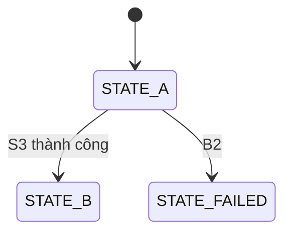

# F-nn <Tên flow>

> Requirements: REQ-xxx, REQ-yyy | Ràng buộc liên quan: C-xx | Rủi ro: cao / thường
> Giới hạn ~150 dòng. Dài hơn → tách sub-flow (`F-nn-a`, `F-nn-b`).
> Viết ở mức hợp đồng: bước, nhánh, điều kiện, side effect. Không viết pseudo-code từng dòng.

## Bối cảnh

- Actor: <user / service / job>
- Trigger: <METHOD /path | topic | schedule>
- Input: <field chính + validate ở biên>
- Precondition: <trạng thái bắt buộc trước khi chạy>
- Idempotency: <key và hành vi khi lặp lại> | không áp dụng: <vì sao>
- Transaction boundary: <bước nào nằm chung transaction>

## Các bước

Mọi điều kiện rẽ nhánh phải có dòng `B` tương ứng. Nhánh agent tự thêm (người dùng chưa nói) ghi `(đề xuất)` để duyệt ở cổng 2. Nhánh chưa rõ ghi `TODO` và đưa vào Câu hỏi mở.

| # | Bước | Điều kiện rẽ nhánh → nhánh | Kết quả / side effect |
| --- | --- | --- | --- |
| S1 | <bước> | <điều kiện> → B1 | <kết quả happy path> |
| S2 | <bước> | — | <…> |

## Nhánh lỗi / biên

| # | Khi nào | Hành vi | Trạng thái dữ liệu sau đó | Response / event |
| --- | --- | --- | --- | --- |
| B1 | <…> | <…> | không đổi / <…> | <status code / error code> |

## Trường hợp không liệt kê

Bắt buộc. Implementer không được tự đặt hành vi cho trường hợp không có trong bảng nhánh; mục này là câu trả lời mặc định của nó.

- Input/trạng thái không khớp bước hay nhánh nào: <từ chối với `<error code>` qua `<validator/mapper hiện có, path:line>` | giữ nguyên hành vi hiện có của `<symbol, path:line>` | GAP — implementer dừng và hỏi>
- Lỗi phụ thuộc ngoài không có nhánh riêng: <propagate qua `<error handler hiện có>` | GAP>

## Trạng thái (bỏ nếu flow không có lifecycle)

Chuyển trạng thái bị cấm: <A → C, …>. Terminal: <…>.

## Invariants

- I1 <điều luôn đúng, ví dụ: mỗi key chỉ được xử lý đúng một lần>

## Concurrency & retry

<request trùng / đồng thời / retry từ phía gọi xử lý thế nào; cơ chế khóa nếu có. Bỏ nếu không áp dụng và ghi vì sao.>

## Observability

<log/metric/trace tại bước nào; không log dữ liệu nhạy cảm.>

## Test bắt buộc

Mỗi `S` có rẽ nhánh, mỗi `B` và mỗi `I` phải có ít nhất một test. Tên test chứa ID.

| Test | Chứng minh | Loại |
| --- | --- | --- |
| `Fnn_S_happy_path_<…>` | S1–Sn | integration |
| `Fnn_B1_<…>` | B1 | unit |
| `Fnn_I1_<…>` | I1 | integration |
