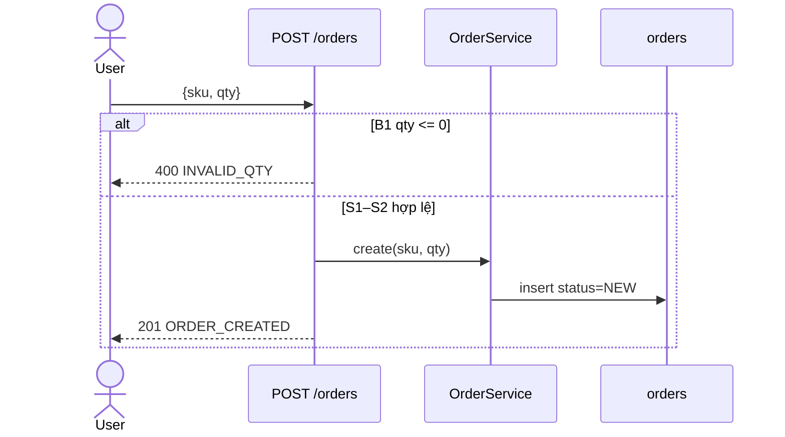
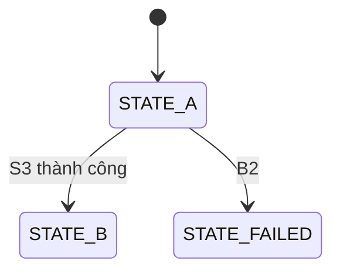

# F-nn <Tên flow>

> Requirements: REQ-xxx, REQ-yyy | Ràng buộc liên quan: C-xx | Rủi ro: cao / thường
> Giới hạn ~150 dòng. Dài hơn → tách sub-flow (`F-nn-a`, `F-nn-b`).
> Viết ở mức hợp đồng: bước, nhánh, điều kiện, side effect. Không viết pseudo-code từng dòng.

## Bối cảnh

- Actor: <user / service / job>
- Trigger: <METHOD /path | topic | schedule>
- Input: <field chính + validate ở biên>
- Precondition: <trạng thái bắt buộc trước khi chạy>
- Idempotency: <key và hành vi khi lặp lại> | không áp dụng: <vì sao>
- Transaction boundary: <bước nào nằm chung transaction>

## Các bước

Mọi điều kiện rẽ nhánh phải có dòng `B` tương ứng. Nhánh agent tự thêm (người dùng chưa nói) ghi `(đề xuất)` để duyệt ở cổng 2. Nhánh chưa rõ ghi `TODO` và đưa vào Câu hỏi mở.

| # | Bước | Điều kiện rẽ nhánh → nhánh | Kết quả / side effect |
| --- | --- | --- | --- |
| S1 | <bước> | <điều kiện> → B1 | <kết quả happy path> |
| S2 | <bước> | — | <…> |

## Diagram

Bắt buộc. Actor → entry point → service → store/integration; happy path đủ bước, mỗi `B` là một nhánh `alt`/`else` nhãn `Bk` kèm mã trả về.

## Mã kết quả

Bắt buộc. Mỗi `S` kết thúc và mỗi `B` có đúng một dòng. Không phải HTTP (job/event) → ghi status/event tương ứng.

| Mã | HTTP/status | Bước/nhánh | Body/payload |
| --- | --- | --- | --- |
| `ORDER_CREATED` | 201 | S2 | `{id, status:"NEW"}` |
| `INVALID_QTY` | 400 | B1 | `{code, message}` |

## Nhánh lỗi / biên

| # | Khi nào | Hành vi | Trạng thái dữ liệu sau đó | Mã |
| --- | --- | --- | --- | --- |
| B1 | <…> | <…> | không đổi / <…> | <mã trong "Mã kết quả"> |

## Trường hợp không liệt kê

Bắt buộc. Mặc định cho input/lỗi không có trong bảng nhánh: <dùng `<handler/validator hiện có, path:line>` | giữ hành vi hiện có | GAP (đã có trong Câu hỏi mở)>

## Trạng thái (bỏ nếu flow không có lifecycle)

Chuyển trạng thái bị cấm: <A → C, …>. Terminal: <…>.

## Invariants

- I1 <điều luôn đúng, ví dụ: mỗi key chỉ được xử lý đúng một lần>

## Concurrency & retry

<request trùng / đồng thời / retry từ phía gọi xử lý thế nào; cơ chế khóa nếu có. Bỏ nếu không áp dụng và ghi vì sao.>

## Observability

<log/metric/trace tại bước nào; không log dữ liệu nhạy cảm.>

## Test bắt buộc

Mỗi `S` có rẽ nhánh, mỗi `B`, `I` có ≥ 1 test; tên test chứa ID.
